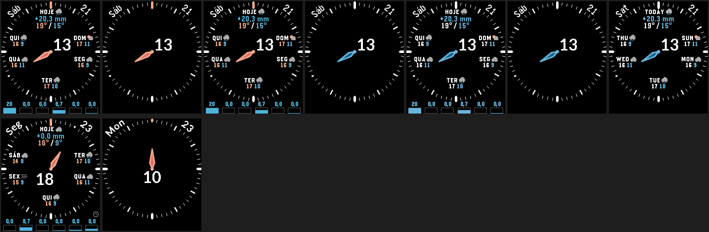

# One Minute Weather Bars (fork B)

Variante da One Minute Weather para o **Pebble Time 2** (`emery`). Pode ser instalada ao mesmo tempo que a original, porque tem um UUID diferente.



## Diferenças em relação à One Minute Weather
- **Calendário no topo:** o dia da semana fica curvo sobre o círculo, à esquerda (PT/EN), e o dia do mês à direita, em Lato Bold, a mesma fonte da hora. O mês deixa de aparecer.
- **Blocos dentro do círculo:** dia, ícone, máxima e mínima. A percentagem passou para as barras.
- **Barras de chuva em baixo, estilo Dataload:** uma barra por dia, de hoje (à esquerda) até daqui a 5 dias. A altura é a probabilidade de chuva e o número por cima são os mm previstos. Abaixo de 10 mm leva uma casa decimal (6,2); a partir daí aparece inteiro (14).
- **Indicadores de estado:** telemóvel desligado, previsão desatualizada e bateria passaram para os cantos de baixo, por cima das barras.

## Definições específicas (secção Meteorologia)
| Opção | Valores (predefinição a **negrito**) |
|---|---|
| Previsão dentro do círculo | **Sim** / Não |
| Barras de chuva em baixo | **Sim** / Não |
| Toque no pulso (abanar) | **Não faz nada**; Alterna entre com e sem meteorologia; Mostra toda a meteorologia durante um tempo (10 s, 30 s, **1 min**, 2 min, 5 min) |
| Esconder a meteorologia num horário | **Não** / Sim, com hora de início, hora de fim e dias da semana (**09:00–18:00, seg–sex**) |

- **Alternar:** fica na versão alternativa até ao próximo toque, e lembra-se dela depois de reiniciar. A versão alternativa é sem meteorologia; se a tiveres desligado acima, passa a ser com toda ela.
- **Mostrar durante um tempo:** depois do toque, a meteorologia fica visível o tempo escolhido (1 min por predefinição) e depois volta sozinha ao que está configurado. Um novo toque nesse período recomeça a contagem.
- **Horário:** dentro do horário a meteorologia fica escondida (dentro do círculo e as barras); fora dele aparece como configurado. O toque no pulso continua a funcionar durante o horário. Se a hora de fim for anterior à de início, o horário passa a meia-noite (por exemplo 22:00–07:00), e conta como dia o dia em que começou. Ao entrar ou sair do horário, o relógio volta à vista configurada, mesmo que tenhas alternado com o toque. Durante o horário não são pedidas previsões, a não ser que o toque no pulso esteja ativo.
- **Sem meteorologia:** se a desligares por completo e o toque não fizer nada, o relógio e o telemóvel deixam de pedir previsões, o que poupa bateria e dados.

As restantes opções (tema, cores, 12/24 h, localização, unidades, intervalo, chuva de hoje, idioma) são as da One Minute Weather. Não há modo de 4 dias nem formato de data.

## Hora maior
A hora usa Lato Bold de **33 px** com a meteorologia dentro do círculo (antes 32) e de **64 px** sem ela. São os maiores tamanhos sem colisões, encontrados por `tools/hour_search.py`, que testa todas as horas (24 h e 12 h) em cada um dos 60 minutos contra tudo o resto do mostrador. Com 34 px, às 20:12 a hora tocaria no bloco de baixo à esquerda; com 66 px, às 20:10 tocaria nas marcações. Folga mínima de 1 px.

## Temas
**Meteorologia colorida** (predefinido, fundo preto), **Clássico minimalista** (inspirado na One Minute Hand: branco sobre preto, ponteiro azul), Monocromático, Alto contraste e Personalizado. Todos passam pela proteção de legibilidade.

## Cores da chuva (quantidade)
Os mm de hoje aparecem em milímetros inteiros (arredondados). A cor dos mm segue uma escala que se pode configurar: 0 mm branco (#FFFFFF), 5 mm azul leitoso (#BDEFFF), 10 mm azul intermédio (#38BDF8), 20 mm ou mais azul intenso (#1762FF). Entre estes pontos a cor é interpolada e convertida na mais próxima das 64 cores do relógio. A mesma escala colore os números por cima das barras. As barras (probabilidade) têm uma cor própria, para não se confundirem com a quantidade. Sem dados aparece "--" a cinzento. Nos temas Monocromático e Alto contraste usa-se a cor do tema.

## Poupança de energia
O dia começa às 07:00 e a noite às 23:00. O mostrador é atualizado a cada **1 min** de dia (opções 1 / 2,5 / 5) e a cada **15 min** à noite (opções 5 / 15 / 30). A previsão tem o seu próprio intervalo. A análise, as medições e os compromissos estão em [`docs/ENERGIA.md`](docs/ENERGIA.md).

## Horário sem meteorologia
Escolhe-se **o que esconder**: tudo, só a previsão dentro do círculo, ou só as barras de chuva em baixo.

## Poupança de processamento
A meteorologia, o calendário e os indicadores são desenhados uma vez para uma imagem em memória (45,6 KB). Em cada minuto essa imagem é copiada e só as marcações, a hora e o ponteiro são desenhados por cima. A imagem só é refeita quando muda a previsão, o dia, a visibilidade (horário ou toque), a ligação, a bateria (se estiver visível), o estado de desatualização ou a hora (no modo "chuva ainda prevista"). No emulador cada minuto passou de cerca de 12–16 ms para 4–9 ms de processador, com resultado igual pixel a pixel. Os valores reais no relógio serão diferentes, mas a proporção deve manter-se.

## Compilar
```bash
python3 tools/gen_curved.py   # só se mudares fontes ou posições do calendário curvo
pebble build
pebble install --emulator emery
```
Testes sem SDK: `sh tools/run_tests.sh` (incluem o teste exaustivo de sobreposições deste layout).
