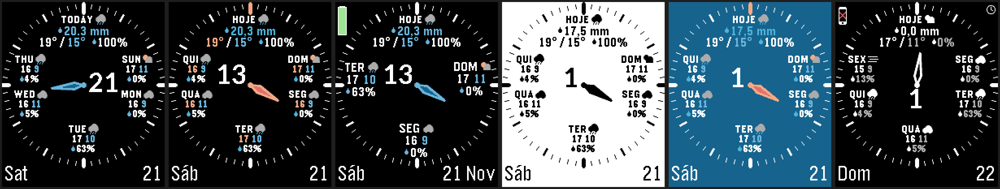

# Estado da validação

Última validação: 21 Nov 2026, SDK Pebble 4.44 (`pebble-tool` 5.2), emulador `emery` (Pebble Time 2).

## Feito e verificado

| Verificação | Onde | Resultado |
|---|---|---|
| `pebble build` com o SDK atual (manifesto v2, permissões `Location` e `Internet` limitadas aos 2 domínios da Open-Meteo) | SDK 4.44 | OK, sem avisos do projeto. RAM 10,5 KB de 128 KB, recursos 5,8 KB |
| Instalação e arranque | emulador emery | OK. Heap usado: 1,1 KB |
| **60 posições do ponteiro** (hora 23, previsão real) | emulador emery | ponteiro no minuto certo (erro ≤ 1,5°); folga mínima de **2 px** entre ponteiro/hora e o resto (`docs/emulator_60min.gif`) |
| Sobreposições: 60 min × 24 h, 12 h, PT/EN, 7 dias da semana, dados normais/extremos/ausentes, 6 e 4 dias, 3 formatos de data | código C real no PC (`tools/check_c.py`) | 0 problemas. A simulação coincide pixel a pixel com o emulador em texto, hora, blocos e calendário |
| Previsão real Open-Meteo: localização do emulador → pedido → bloco binário (230 bytes) → mostrador | emulador emery | OK (Lisboa: 20,3 mm, 19°/15°, 100%) |
| Pesquisa de localidade e localidade inexistente | API real (`tools/live_test.js`) | OK |
| Soma horária = total diário (confirma o modo "chuva ainda prevista") | API real | OK |
| Idioma automático (emulador en_US → inglês) e manual (PT-PT) | emulador | OK |
| Definições pelo canal real de mensagens: tema, 4/6 dias, formato da data, 12 h, bateria, chuva restante | emulador | aplicadas de imediato, sem reinstalar |
| Proteção de legibilidade (hora e máximas da cor do fundo) | emulador | trocadas automaticamente por branco |
| Meia-noite sem nova previsão: HOJE passa para o dia seguinte e os blocos avançam | emulador (01:01 de 22 Nov) | OK |
| Telemóvel desligado + previsão desatualizada | emulador | os dois indicadores aparecem |
| Primeiro pedido ao arrancar (o JS ainda não estava pronto) | emulador | **corrigido**: o JS pede ao arrancar, e o relógio volta a tentar no minuto seguinte se o envio falhar |
| Página de definições (Clay real, Chrome sem ecrã): secções colapsáveis; "Cores personalizadas" só com o tema Personalizado; cores corretas | Chrome headless | OK. **Corrigido**: a página recebia o modelo do relógio vazio e mostrava todas as cores a branco |
| Marcação apontada pelo ponteiro encurtada (40 %, mín. 2 px) | emulador emery | OK |
| Lógica C: datas, mês/ano/bissexto, mm restantes, cache, back-off, dados corrompidos | PC (`tools/host/test_logic.c`) | OK |

## Ainda por validar no Pebble Time 2 físico e no telemóvel

1. **Página de definições** na aplicação Pebble do telemóvel: guardar e reabrir com os valores guardados, localização manual.
2. **Legibilidade real** da letra pequena (Gothic 14 bold) a 202 ppi. Se for insuficiente, usar o modo de 4 dias.
3. **Pedidos de permissão** de localização e internet na aplicação do telemóvel (manifesto v2), incluindo a permissão recusada.
4. **Consumo de bateria** ao longo de alguns dias (1 redesenho por minuto, rede só no intervalo escolhido).

## Limitações conhecidas

- Só plataforma **emery** (Pebble Time 2).
- Mudança de hora (DST) dentro dos dias previstos: a Open-Meteo usa um único desfasamento UTC por resposta. No dia da mudança, o modo "chuva restante" pode estar desviado 1 hora.
- No modo "chuva restante", a hora atual conta inteira.
- A página de definições mostra as cores personalizadas mesmo quando o tema escolhido não é "Personalizado". Nesse caso são ignoradas.
- O emulador mostra as cores com a correção de ecrã do Pebble (um pouco mais suaves do que na pré-visualização).

- A aplicação Pebble só mostra a imagem de pré-visualização de watchfaces publicadas na loja rePebble. As instaladas manualmente (sideload) mostram sempre o ícone genérico (confirmado no código da libpebble3).
